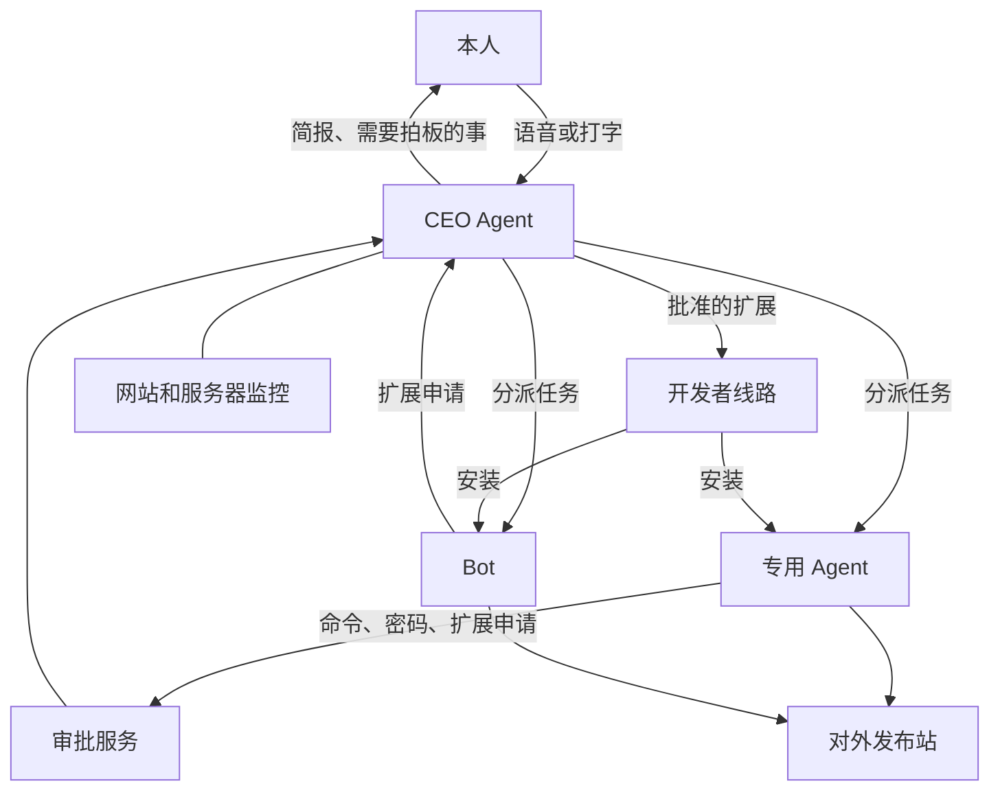

# 调度台（dispatch）

一个人管理一小套线上业务用的"AI 公司"控制台。

打开一个网页，就能看到所有网站和服务器是否正常；一个 **CEO Agent** 负责巡视、写简报、审批下属的操作，并把你交代的事分派给合适的 Agent 或 Bot 去做。你只在真正需要拍板的时候被打扰。

> **关于这个仓库**：这是脱敏后的副本。真实的服务器 IP、域名、姓名都换成了占位值（`203.0.113.x`、`example.com`、"站长"等）；密码、密钥、令牌从来不写在源码里，只存在服务器上。克隆下来不能原样运行，需要换成自己的配置。

## 它能做什么

### 监控和简报

- **网站监控**：定时检查每个网站能否打开、响应多久、证书还剩几天。
- **服务器监控**：负载、内存、磁盘、运行时长，超过阈值就告警。
- **中转站和音乐机器人**：模型接口中转站的请求量和用量，音乐机器人是否在线。
- **模型线路自检**：每条模型线路定时自测，调不通会自动重试，仍不通才告警，恢复后自动撤销。
- **巡视简报**：CEO Agent 每半小时根据监控数据写一段给老板看的中文简报。
- **等你处理的事**：需要本人决定的事集中在一处，点开能看到每一件是什么。

### CEO Agent：审批和分派

- **审批服务器命令**：下属 Agent 想在服务器上执行命令，先由 CEO Agent 审核。同意就执行，拒绝就不执行，拿不准的转给本人决定。
- **双模型复核**：批准需要主模型和备用模型都同意。
- **审批密码调用**：密码库里的密码只有 CEO Agent 批准后才能被取用，一次批准只能取一次。
- **审批扩展申请**：Bot 或 Agent 需要新工具、技能、MCP 服务时提出申请，CEO Agent 只判断"会不会影响现有系统"，批准后交给"开发者"线路去安装。
- **做过的事有记录**：首页右上角列出它批准了什么、拒绝了什么、理由是什么。

### 和 CEO Agent 语音通话

- 点"开始通话"后像打电话一样对话：说完停顿约一秒自动识别，不用按键。
- CEO Agent 用语音回答，并决定这件事是自己回答、交给专用 Agent，还是交给某个 Bot。
- 交出去的事做完后，会用一两句话口头转告结果。
- 语音识别和语音合成都是服务器本地的模型，录音不发给第三方，也不保存。

### 专用 Agent

一个运行在独立容器里的 Claude，有完整的 Linux 开发环境。

- **任务**：在网页上发任务、看每一步在做什么、接着上一次继续，回答里可以直接显示图片。
- **文件管理和网页终端**：在线浏览、上传、下载、编辑它的工作文件。
- **定时任务和自动化规则**：按时间或按事件自动触发任务。
- **密码库**：存放网站或接口的密码，Agent 看不到明文，只能在 CEO Agent 批准后一次性使用。
- **组件库、技能市场、MCP 市场**：可视化地查看和安装它能用的组件、技能和 MCP 服务。
- **发邮件**：通过审批后用指定邮箱发信。
- **委托 Bot**：可以把适合 Bot 的事转交给 Bot，并拿回结果。

### Bot

可以创建多个 Bot，各自选模型、写人设。它们共用一台带浏览器和桌面的"Bot 电脑"。

- **工具**：上网搜索和打开网页、截图、运行代码、读写文件、记忆、交付文件和图片。
- **子代理**：Bot 可以创建一个独立的子代理来复核或反驳自己的结论。
- **两种浏览器**：普通版和减少误判为机器人的版本。
- **看得见的桌面**：在网页上能直接看到 Bot 电脑的屏幕。
- **申请扩展**：需要新工具、技能、MCP 服务时走上面的审批流程。

### 对外发布

Bot 和 Agent 可以把做好的网页或文件发布成一个公开链接返回给你。发布站是只读的静态站点，和其他服务隔离。

## 整体结构



三台服务器的分工：

| 服务器 | 上面跑什么 |
| --- | --- |
| 主服务器 | 调度台本体、Bot 的大脑、语音识别与合成、nginx |
| 小服务器 | 被监控的普通服务器 |
| Agent 服务器 | 专用 Agent 容器、审批服务、Bot 电脑容器、对外发布站 |

主服务器和 Agent 服务器之间只通过加密隧道连接，内部接口都只监听本机地址。

## 安全上的设计

- **所有危险操作都要过审批**：Agent 不能直接在服务器上执行命令，必须提交给审批服务。
- **密码不出库**：密码库的内容 Agent 读不到，只能在批准后的短时间内一次性使用，并有频率限制。
- **Bot 和 Agent 网络隔离**：Bot 电脑在单独的网络里，访问不到 Agent 的内部服务。
- **登录保护**：调度台只用密码登录，连续输错会锁定；所有内部页面都先确认已登录。
- **密钥不进源码**：接口密钥、令牌通过环境变量或系统凭据注入。
- **发布站只读**：对外只提供静态文件，不执行任何代码。

已知的不足：密码库在服务器上是明文保存的（靠文件权限保护）；专用 Agent 在自己的容器里有管理员权限；还没有自动备份和手机告警推送。

## 目录

| 位置 | 内容 |
| --- | --- |
| `server.js`、`index.html`、`login.html` | 调度台本体：监控、简报、审批、首页 |
| `ext-review.js` | 扩展申请的审批和安装流程 |
| `voice.js`、`stt/` | 语音通话：分派逻辑、本地语音识别与合成服务 |
| `agent/` | 专用 Agent 容器：任务与文件服务、审批服务、密码库、市场、命令行工具 |
| `bots/` | Bot 的大脑、Bot 电脑里的工具和安装器 |
| `pub/` | 对外发布站 |
| `config.json` | 监控哪些网站和服务器、用哪些模型（已脱敏） |
| `*.service`、`*.timer` | systemd 服务配置 |
| `tools/sync-repo.js` | 把正在用的源码脱敏后同步到本仓库的脚本 |

## 技术栈

- **后端**：Node.js（不依赖框架）、Python（审批服务、语音服务）
- **前端**：原生 HTML、CSS、JavaScript，单文件页面，没有构建步骤
- **模型**：CEO Agent 用 Claude，备用和各条线路通过兼容 OpenAI 格式的中转站调用
- **语音**：sherpa-onnx，识别用 SenseVoice，合成用 MeloTTS（中英文）
- **部署**：systemd、Docker、nginx、Caddy

## 不在仓库里的东西

- 登录密码、模型接口密钥、邮箱授权码、密码库内容、各服务之间的令牌
- 运行状态和记录（审批记录、通话记录、任务记录）
- 语音模型文件（体积大，安装时从 sherpa-onnx 官方发布页下载）
- 真实值和占位值的对照表（`.sanitize-map.json`，只留在本地）

## 版本管理的做法

每次改动上线后运行：

```bash
node tools/sync-repo.js <源码目录> <仓库目录>
```

脚本按对照表替换真实值，再检查仓库目录里有没有残留的真实值、公网 IP 或像密钥的内容。检查通过才提交和推送，不通过就不会提交。
